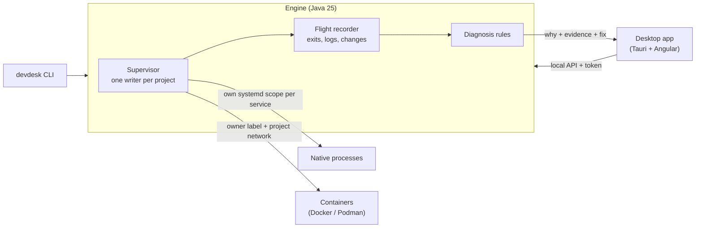

# DevDesk

[](https://github.com/LouayChayeb/devdesk/actions/workflows/build.yml)
[](LICENSE)


**Runs your project's services, tells you why one broke, and leaves your machine clean.**

DevDesk is a desktop app and CLI for local multi-service development: native processes (`npm run dev`,
`uvicorn ...`) and containers (Postgres, Redis...) described in one `devdesk.yaml`. It starts them in dependency order,
waits for real health checks, keeps the logs, stops exactly what it started, and when something breaks, it shows the
evidence and the fix.


## Why DevDesk

- **It explains failures.** A busy port, a typo in a command, a health check on the wrong port, a crash, an empty
  secret, a database without its tables: each gets a plain explanation, the evidence it's based on, and the command
  that fixes it.
- **It cleans up after itself, and only after itself.** Every service runs in its own systemd scope (or a process
  group with a random marker), containers carry the project's label. Stopping stops every child and grandchild.
  Nothing is ever killed by name or by port. If DevDesk itself is killed, the next start finds what it left.
- **It can get someone else's project running.** Paste a GitHub link: DevDesk clones it, reads its compose file and
  Dockerfiles, asks before running anything, starts it, and later removes everything it made with one click.

## See it explain a failure

Port 3003 is already taken by a server someone started in another terminal. DevDesk names it and gives the command:


The same in a terminal (real output, `examples/broken/wrong-port.yaml`):

```
$ devdesk up -f wrong-port.yaml
Starting broken-wrong-port (1 service)
▶ api running, PID 115617 (0.1s)
api | Serving HTTP on 127.0.0.1 port 3005 (http://127.0.0.1:3005/) ...
! api unhealthy: GET http://127.0.0.1:3006/: connection refused (nothing listening yet?) (2 checks in a row)
  ✗ api never became healthy
      why:  api started, but its health check never passed: GET http://127.0.0.1:3006/: connection refused
            (nothing listening yet?) (2 checks in a row). It listens on [3005], but the check waits on port 3006.
      seen: check failed: GET http://127.0.0.1:3006/: connection refused (nothing listening yet?)  (6 times)
      seen: api (PIDs [115617, 115623]) listens on ports [3005]
      fix:  make the health check use port 3005, or make api listen on 3006
```

`devdesk why` checks a project before anything starts (`examples/broken/command-not-found.yaml`):

```
$ devdesk why -f command-not-found.yaml
Checking broken-command (nothing is started)...
api:
  ✗ Program `pyhton3` is not installed or not on PATH
      why:  api starts with `pyhton3`, but DevDesk can't find it in any PATH folder. In a terminal it may work
            because your shell setup (nvm, sdkman, ~/.local/bin) adds folders.
      fix:  install it, or check the spelling in devdesk.yaml
      fix:  if it works in your terminal, run `which pyhton3` there and use that full path
1 problem(s) would stop the project from starting.
```

When a stack worked yesterday and not today, `devdesk why` also lists what changed since the last clean start
(images, lock files, settings, code), ranked against what fails now. An image change can be **proven**: DevDesk
replays the old and the new image side by side in throwaway containers, with fresh empty copies of the databases they
need, and nothing of yours is touched.

## How it works



The engine is the only thing that starts or stops anything; the app and the CLI show what it reports. The core
(projects, dependency graph, state machine, health checks, diagnosis) has no Linux in it: Linux and Docker are
adapters behind interfaces, so the core is tested with fakes.

## Install

Runs on Linux. Tested on **Ubuntu 24.04** and on **Windows through WSL2** (Ubuntu). macOS is not supported.
Prebuilt installers (.deb, AppImage) will come with the first release; for now, build from source.

Needs JDK 25. Docker or Podman only if your projects use containers. A systemd user session (most Linux desktops;
WSL2 with `systemd=true` in `/etc/wsl.conf`) gives the strongest cleanup guarantee.

```bash
git clone https://github.com/LouayChayeb/devdesk.git && cd devdesk
./gradlew :cli:installDist
export PATH="$PWD/cli/build/install/devdesk/bin:$PATH"
```

The desktop app also needs Node.js, Rust and the [Tauri prerequisites](https://v2.tauri.app/start/prerequisites/):

```bash
./gradlew :daemon:installDist
cd ui && npm install && npm run app
```

## Quick start

```bash
cd examples/three-tier      # db ← api ← web, needs only python3
devdesk why                 # checks ports, programs and settings first; runs nothing
devdesk trust               # shows every command it will run, asks once
devdesk up                  # starts in order, waits for health; Ctrl+C stops everything
```

`examples/broken/` has one small project per typical failure (busy port, crash, wrong health check port...) to see
each explanation.

Someone else's project, from its link:

```bash
devdesk get https://github.com/owner/project   # clone, propose a devdesk.yaml, trust, set up, start
devdesk remove ~/DevDesk/project               # later: delete everything DevDesk made for it, then check again
```


Other commands: `devdesk ps` (what runs, and leftovers), `devdesk history` (what happened while you weren't
looking), `devdesk doctor` (can this machine run it?), `devdesk once` (remember a one-time command like a README's
`rails db:setup`).

## How it compares

| | DevDesk | docker compose | Tilt | process-compose |
|---|---|---|---|---|
| Native processes and containers in one file | yes | containers | yes | processes |
| Dependency order with health checks | yes | yes | yes | yes |
| Explains a failure with evidence and a fix | yes | logs | logs and status | logs and status |
| "What changed since it last worked" | yes | no | no | no |
| Interface | desktop app + CLI | CLI | web UI + CLI | TUI + CLI |
| Platforms | Linux, WSL2 | Linux, macOS, Windows | Linux, macOS, Windows | Linux, macOS, Windows |
| Maturity | early, one developer | mature | mature | mature |

The others are mature and widely used; DevDesk is new. Its focus is answering "why is this broken?", not only
"what is running?".

## What was tested

- **15 real open-source projects**, including Mastodon, Chatwoot, Saleor, Twenty and Plausible, plus umami,
  spring-petclinic, paperless-ngx and the docker example voting app. Their problems shaped many of the rules.
- **120 hard kills, 0 leftovers**: on those 15 projects, DevDesk itself was killed 8 different ways (CLI and app,
  systemd scope and process group modes, while starting and while running), and every time the next start found and
  stopped what it had left.
- **About 890 automated tests** in CI on every push: unit tests with fakes, real Linux processes, real Docker, real
  databases, 15 crash points where DevDesk is killed on purpose, randomized ownership tests with bystander processes
  that must never get a signal, fuzzing and mutation testing.

## Status

Early. It has been used by its author, not yet by a team: expect bugs on other machines, and please
[open an issue](https://github.com/LouayChayeb/devdesk/issues) with what happened. Linux and WSL2 only; there are no
macOS or native Windows versions.

## Build

```bash
./gradlew build          # compile, test, check formatting and style
./gradlew spotlessApply  # auto-format the code
```

## License

[Apache-2.0](LICENSE)

## Credits

Built with the help of Claude Code.
